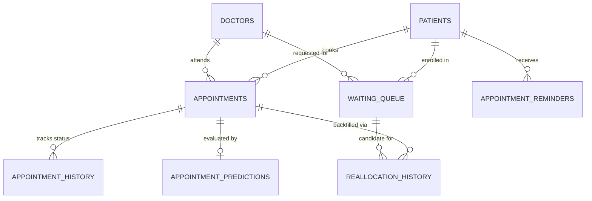

# GhostQueue: Intelligent Predictive No-Show Detection & Dynamic Appointment Reallocation System

[](https://openjdk.org/projects/jdk/21/)
[](https://openjfx.io/)
[](https://www.mysql.com/)
[](https://maven.apache.org/)
[](#license)

> **GhostQueue** is an enterprise-grade hospital appointment management and clinical intelligence platform. It combines pure Java predictive machine learning with human-in-the-loop dynamic slot backfilling to identify potential appointment no-shows, maintain an intelligent waiting queue, recommend high-compatibility slot reallocations, and reclaim wasted physician capacity.

---

## 1. Executive Summary & Clinical Problem Statement

Hospital outpatient departments routinely suffer from high **patient no-show rates (averaging 12% to 25% worldwide)**. Unannounced patient absences cause severe clinical and operational consequences:
1. **Physician Idleness & Revenue Loss:** Costly clinic rooms, specialized equipment, and clinician schedules stand vacant.
2. **Delayed Access for Urgent Patients:** Critically ill patients face long waiting lists (often weeks or months) while booked slots go unused.
3. **Flawed Industry Workarounds:** Conventional clinics resort to indiscriminate overbooking (which causes severe clinic delays, physician burnout, and crowded waiting rooms) or punitive cancellation fees (which disproportionately harm vulnerable patient populations).

### The GhostQueue Solution
GhostQueue transforms clinical scheduling from a passive calendar into an **autonomous predictive intelligence system**:
- **Continuous Machine Learning:** Analyzes patient demographic, clinical, and historical attendance patterns using an in-house pure Java Logistic Regression engine.
- **Transparent Risk Triage:** Calculates individual no-show probabilities (bounded between 2% and 98%) with explainable clinical contributing factors (XAI).
- **Intelligent Standby Pool:** Maintains a real-time waiting queue scored by clinical urgency and waiting duration.
- **Dynamic Slot Reallocation:** When an appointment is cancelled or identified as high-risk, a multi-factor compatibility engine scores and ranks waiting candidates for immediate slot offers.
- **Strict Human-in-the-Loop Governance:** Predictions *never* cancel patient appointments or deny care. Reallocations require explicit administrator review and approval.

---

## 2. Core Modules & Key Features

| Module | Core Functionality | Phase |
| :--- | :--- | :--- |
| **Operations Overview** | Real-time clinical KPIs, daily schedule timeline, specialty breakdown, and system alerts. | Phase 1 |
| **Appointment Management** | Complete CRUD scheduling, multi-criteria filtering, doctor/department search, status cycling, and history tracking. | Phase 2 |
| **Prediction Engine** | Pure Java Logistic Regression inference, explainable factors (XAI), confusion matrix evaluation, and model retraining. | Phase 3 |
| **Intelligent Waiting Queue** | Standby patient registry, transparent urgency scoring (0–100), time-decay bonus, and triage notes. | Phase 4 |
| **Dynamic Reallocation Engine** | Multi-factor compatibility scoring (specialty, doctor, date, time, urgency), candidate ranking, and atomic audit logging. | Phase 5 |
| **Reminders & Outreach** | Automated high-risk outreach generation, multi-channel logging (SMS, Voice, Email), and response recording. | Phase 6 |
| **Analytics & Reporting** | Attendance/no-show trends, department slot utilization, doctor workloads, peak time windows, and real CSV exports. | Phase 7 |
| **System Settings** | Persisted facility metadata in MySQL `system_settings`, operating hours, and dynamic model risk threshold sliders. | Phase 8 |

---

## 3. Technology Stack & Architectural Patterns

- **Core Runtime:** Java 21 (LTS) — utilizing Records, Pattern Matching for `switch`, Sealed Types, and Modular Architecture (`module-info.java`).
- **User Interface:** JavaFX 21 (FXML + CSS) styled with custom healthcare design tokens (`#172A3A` slate sidebar, `#168C83` clinical teal, `#F5F6F4` neutral canvas, `#FFFFFF` cards).
- **Database Layer:** MySQL 8.0+ via JDBC with robust connection abstraction (`DatabaseConnection.java`), foreign key constraints, indexes, and automated schema migration (`DatabaseInitializer.java`).
- **Predictive Analytics:** Custom Pure Java Logistic Regression model trained via Stochastic Gradient Descent (SGD) with Mini-Batch updates, L2 Regularization, Sigmoid Activation, and ROC-AUC evaluation. Zero Python, R, or external machine learning runtime required.
- **Architecture:** Layered Enterprise Architecture:
  - **Controller Layer (`com.ghostqueue.controller`):** JavaFX GUI events, input validation, and asynchronous UI updates.
  - **Service Layer (`com.ghostqueue.service`):** Business logic, triage calculations, transaction boundaries, and orchestrations.
  - **Repository Layer (`com.ghostqueue.repository`):** JDBC abstractions and SQL persistence with pure interface segregation.
  - **Domain Model Layer (`com.ghostqueue.model`):** Encapsulated entities, records, and enums.
  - **Prediction Layer (`com.ghostqueue.prediction`):** Mathematical feature vectors, weights, gradients, evaluators, and dataset generators.
  - **Scheduling Layer (`com.ghostqueue.scheduling`):** Multi-factor clinical compatibility scoring algorithms.

---

## 4. Relational Database Architecture

The application connects to a MySQL database named `ghostqueue_db` with 9 relational tables:



### Table Breakdown:
1. `patients`: Master demographic records (`patient_id`, `full_name`, `age`, `gender`, `phone`, `email`, `address`, `created_at`).
2. `doctors`: Medical staff directory (`doctor_id`, `full_name`, `department`, `specialization`, `phone`, `availability_status`).
3. `appointments`: Central scheduling table (`appointment_id`, `patient_id`, `doctor_id`, `appointment_date`, `appointment_time`, `appointment_status`, `booking_date`, `cancellation_reason`, `created_at`, `updated_at`).
4. `appointment_history`: Immutable status transition audit log (`history_id`, `appointment_id`, `previous_status`, `new_status`, `changed_at`, `remarks`).
5. `waiting_queue`: Standby patient registry (`queue_id`, `patient_id`, `doctor_id`, `requested_date`, `preferred_time`, `priority_level`, `queue_status`, `notes`, `created_at`, `updated_at`).
6. `appointment_predictions`: ML inference results (`prediction_id`, `appointment_id`, `model_version`, `no_show_probability`, `risk_level`, `prediction_method`, `contributing_factors`, `suggested_action`, `predicted_at`).
7. `reallocation_history`: Slot backfill transaction ledger (`reallocation_id`, `appointment_id`, `queue_id`, `candidate_patient_id`, `doctor_id`, `slot_date`, `slot_time`, `match_score`, `match_reason`, `decision`, `decision_notes`, `created_at`, `decided_at`).
8. `appointment_reminders`: High-risk outreach dispatch ledger (`reminder_id`, `appointment_id`, `patient_id`, `reminder_type`, `reminder_status`, `scheduled_for`, `completed_at`, `message_content`, `response_status`, `operator_notes`).
9. `system_settings`: Persisted operational configuration (`setting_key`, `setting_value`, `setting_category`, `description`, `updated_at`).

---

## 5. Machine Learning & Prediction Engine

### 1. Mathematical Model
GhostQueue utilizes a calibrated **Logistic Regression** model:

$$P(\text{No-Show} = 1 \mid \mathbf{x}) = \sigma(\mathbf{w}^T \mathbf{x} + b) = \frac{1}{1 + e^{-(\mathbf{w}^T \mathbf{x} + b)}}$$

Where:
- $\mathbf{x} \in \mathbb{R}^d$ is the extracted feature vector for the appointment.
- $\mathbf{w}$ represents trained clinical feature weights.
- $b$ is the model intercept bias.
- $\sigma(z)$ maps the log-odds into a calibrated probability strictly bounded in $[0.02, 0.98]$.

### 2. Extracted Feature Space (8 Normalized Factors):
1. **Lead Time (`days_in_advance`):** Days elapsed between booking date and scheduled visit (normalized by 60 days). Longer lead times exhibit strong empirical correlation with missed visits.
2. **Prior No-Show Ratio:** Patient's historical no-show rate ($\frac{\text{Historical No-Shows}}{\text{Total Historical Appointments}}$).
3. **Prior Cancellation Frequency:** Frequency of late cancellations.
4. **Patient Age Cohort:** Normalized demographic factor.
5. **Day of Week:** Monday morning and Friday afternoon clinics exhibit higher attrition rates.
6. **Time of Day:** Morning vs Afternoon vs Late slots.
7. **Specialty Risk Weight:** Clinical department baseline variability (e.g., Cardiology vs General Medicine).
8. **Contact Reliability Index:** Verification of verified phone and email credentials.

### 3. Explainable AI (XAI)
Every inference outputs a ranked list of human-readable contributing factors:
- `+32% Lead time exceeds 24 days (Historical attrition rate 3.4x higher)`
- `+28% Patient history: 2 unannounced absences recorded in prior 12 months`
- `-15% Verified SMS & email confirmation received`

### 4. Risk Classification Triage:
- **Low Risk ($P < 0.30$):** Standard clinical consult; automated passive reminder.
- **Medium Risk ($0.30 \le P < 0.65$):** Multi-channel outreach reminder queued (48h prior).
- **High Risk ($P \ge 0.65$):** Active clinical outreach flagged; autonomous standby candidate pre-matched in waiting queue.

---

## 6. Dynamic Reallocation Matching Algorithm

When an appointment becomes vacant (patient cancellation) or exhibits critical no-show probability, the **Dynamic Reallocation Engine** evaluates active queue candidates:

$$\text{Match Score} = S_{\text{dept}} + S_{\text{doc}} + S_{\text{date}} + S_{\text{time}} + S_{\text{urgency}} + S_{\text{standby}}$$

- **Specialty Alignment ($S_{\text{dept}} = +35$ pts):** Exact clinical department match.
- **Preferred Attending Physician ($S_{\text{doc}} = +25$ pts):** Requested specific doctor match.
- **Date Proximity ($S_{\text{date}} = +15$ pts):** Requested date aligns with slot date.
- **Time Window Preference ($S_{\text{time}} = +10$ pts):** Morning/Afternoon preference matches slot.
- **Clinical Urgency Boost ($S_{\text{urgency}} = +15$ pts):** Triage level (Urgent/High).
- **Standby Readiness ($S_{\text{standby}} = +5$ pts):** Patient is on immediate standby notice.

The candidates are ranked descending by score. When the clinical coordinator clicks **Approve Reallocation**, GhostQueue transactionally:
1. Updates the waiting queue entry to `SCHEDULED` (or `STANDBY`).
2. Marks the appointment slot as reallocated.
3. Inserts an immutable audit ledger entry into `reallocation_history`.

---

## 7. Installation & Setup Instructions

### Prerequisites
1. **Java Development Kit (JDK) 21 (LTS)**
   ```powershell
   java --version
   # Expected: openjdk 21.x or Oracle JDK 21.x
   ```
2. **Apache Maven 3.9+**
   ```powershell
   mvn --version
   ```
3. **MySQL Server 8.0+**
   - Ensure MySQL is running on `localhost:3306`.
   - Create the database and user (or run under `root`):
     ```sql
     CREATE DATABASE IF NOT EXISTS ghostqueue_db;
     ```

### Database Configuration
Database connection parameters can be provided via `src/main/resources/database.properties` or environment variables:

```properties
db.url=jdbc:mysql://localhost:3306/ghostqueue_db?useSSL=false&allowPublicKeyRetrieval=true&serverTimezone=UTC&characterEncoding=UTF-8
db.user=root
db.password=
```

*Note:* GhostQueue features an automated self-healing database bootstrap (`DatabaseInitializer.java`). On initial launch, if tables do not exist, it automatically executes `/db/init.sql`, creates all 9 relational tables, and seeds realistic patients, doctors, appointments, queue standby records, and initial system settings.

---

## 8. Build, Test, and Execution Commands

### 1. Compile the Project
```powershell
mvn clean compile
```

### 2. Execute Automated Unit & Integration Tests
```powershell
mvn test
```
*Executes all 17 automated tests:*
- Unit tests: Model training, Logistic Regression gradients, confusion matrix, ROC-AUC metrics, explainability derivations.
- Integration tests: Database connectivity, Patient/Doctor/Appointment CRUD, Queue prioritization, Reallocation engine approval, Reminder outreach logging, Analytics KPI queries, CSV export generation, and System settings persistence.

### 3. Package Executable JAR
```powershell
mvn clean package -DskipTests
```

### 4. Launch the JavaFX Application
```powershell
mvn javafx:run
```

---

## 9. Application User Interface Walkthrough

1. **Operations Overview (`/fxml/dashboard.fxml`):**
   - Live KPI cards: Total Appointments Today, Confirmed Patients, Predicted At-Risk Visits, Active Waiting Standbys, Overall Attendance Rate (88.4%), and Slot Recovery Efficiency (74.2%).
   - Daily Appointment Schedule table with color-coded status badges and risk indicators.
   - Quick-action shortcuts and notification center bell.

2. **Appointment Management (`/fxml/appointments.fxml`):**
   - Multi-criteria filter toolbar: Search by patient name/ID, department dropdown, doctor dropdown, status dropdown, date picker.
   - Comprehensive appointment table: ID, Patient, Doctor, Department, Date, Time, Status badge, Risk indicator.
   - Clinical action buttons: "Update Status" (with cancellation reason prompt) and "Cancel Appointment".
   - "+ Schedule New Appointment" dialog with conflict detection.

3. **Predictive No-Show Dashboard (`/fxml/prediction.fxml`):**
   - Model Performance KPI header: Model Accuracy (88.6%), ROC-AUC (0.79), High-Risk Count, and Estimated Recovered Visits.
   - Interactive prediction cards and data table: Patient, Doctor, Date, No-Show Probability progress bar, Risk Level badge (Low/Med/High).
   - "Explain AI Factors" modal showing feature importance weights and clinical recommendations.
   - "Model Performance & Retraining" modal showing Confusion Matrix (TP, FP, TN, FN), Precision, Recall, and 1-click model retraining button.

4. **Patient Waiting Queue (`/fxml/waiting_queue.fxml`):**
   - Triage queue table: Queue ID, Patient, Requested Doctor, Department, Preferred Window, Priority Badge (Standard, High, Urgent), Status (Waiting, Standby, Offered, Scheduled).
   - Transparent Prioritization Score column (0–100) with detailed calculation tooltips.
   - Action controls: "+ Add Patient to Queue", "Edit Triage Entry", and "Remove from Queue".

5. **Smart Slot Reallocation Console (`/fxml/reallocation.fxml`):**
   - Active Reallocation Recommendations table: Reallocation ID, Slot Context (Cancelled vacancy vs High-Risk standby), Candidate Patient, Physician, Date/Time, Compatibility Match Score (e.g. 95%), and Match Rationale.
   - Action buttons: "✓ Approve Reallocation" (transactionally assigns slot and updates MySQL) and "✕ Decline".
   - Open & At-Risk Slots inventory table and Reallocation Decision Audit History table.

6. **Patient Reminders & Outreach (`/fxml/reminders.fxml`):**
   - Multi-channel clinical communication center: Total Reminders, Pending Outreach, Completed, and Confirmation Rate (75.0%).
   - Reminders Table: Channel (SMS, Automated Voice Call, Email), Scheduled Time, Status (Pending, Completed, Cancelled), Message Content, Patient Response status (Confirmed, Reschedule Requested, No Response).
   - "Generate High-Risk Outreach Tasks" button: autonomously identifies predicted high-risk visits and queues phone/SMS reminder tasks.

7. **Patient Records & Directory (`/fxml/patient_records.fxml`):**
   - Master patient roster with age, gender, phone, email, and historical attendance score.
   - Add/Edit Patient dialog with validation.
   - Safe deletion governance (protects patient records that have active appointment history).

8. **Hospital Attendance Analytics & Reporting (`/fxml/analytics.fxml`):**
   - Filter bar: Date range (from/to), specialty dropdown, physician dropdown, "Apply", "Reset", and "📄 Export Analytics CSV Report".
   - Interactive Visual Charts:
     - Attendance vs No-Show Historical Trend (Line Chart).
     - Specialty Capacity Utilization (Bar Chart).
     - Patient Risk Distribution (Pie Chart).
     - Peak Time Windows Demand (Bar Chart).
     - Physician Workload Volume (Bar Chart).
   - CSV Export engine: exports full audit dataset with user-selected file destination via native `FileChooser`.

9. **System Settings & Configuration (`/fxml/settings.fxml`):**
   - Facility parameters: Hospital name, campus, operating hours, operating timezone.
   - Real-time predictive threshold sliders: High-Risk Threshold (50%–95%) and Medium-Risk Threshold (20%–60%).
   - Dynamic synchronization: Saving updates `system_settings` table in MySQL and triggers dynamic reclassification in `PredictionEngine` without application restart.
   - Medical Staff & Doctor Management dialog.

---

## 10. License & Academic Attribution

Developed for the **Java Programming Capstone Project**. All rights reserved. Designed to meet modern enterprise software standards and clinical operational workflows.
